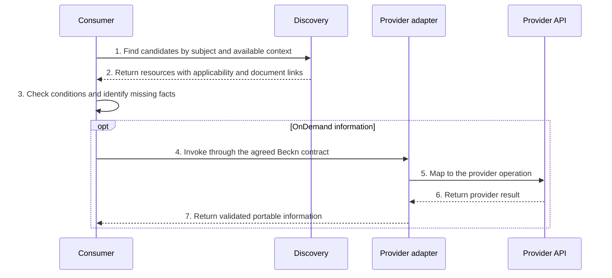

# Agricultural applicability and provider API contracts

## The idea

Research draft, 18 November 2026. Evaluated against `bv-features` at `0860ad9a6abbd901d984f6440af78d9dbf1e80c0`. This document proposes changes; it does not change the published schemas or establish new mandatory fields.

**Keep agricultural information schemas, add explicit applicability where needed, and describe provider operations in separate OpenAPI documents.** A recommendation can depend on season, crop, cultivar, growth stage, age since sowing or transplanting, production system, and environmental conditions. Its publication date and validity cannot express those conditions.

Do not redesign every pack or require every provider to supply every condition. Start with optional applicability in KnowledgeAdvisory, WeatherAdvisory and KnowledgeResource. Preserve the existing KnowledgeAdvisory decision and the OnDemand/Direct distinction. Provider API request, response, authentication and error contracts belong in `api-specs/`, not in an increasingly broad resource union.

## What the agricultural evidence tells us

These sources establish modelling needs. They do not endorse the synthetic examples below as agronomic advice. Old treatment recommendations should not be republished as current guidance without expert review.

| Evidence | What it establishes | Consequence for OAN |
|---|---|---|
| [TNAU paddy FAQs](https://agritech.tnau.ac.in/expert_system/paddy/faqs.html) discuss operations by days after transplanting and named growth stages | The reference event matters | Do not interpret transplanting age as sowing age |
| [TNAU rice seasons](https://agritech.tnau.ac.in/expert_system/paddy/season.html) distinguish regional seasons across Tamil Nadu, Kerala and Karnataka | Kharif/Rabi/Zaid alone cannot describe all Indian calendars | Use governed or provider-owned season references, with geography |
| [FAO Crop Calendar](https://www.fao.org/agriculture/crops/information-resources/am/) organises crop calendars by agroecological zone | A crop's planting calendar is location-dependent | Do not hardcode a universal date range for a season |
| [IMD KALP manual](https://mausam.imd.gov.in/imd_latest/contents/agromet/kalp/kalp.pdf), especially pages 6–8, connects forecast, crop stage, impact and action | Weather advice depends on both forecast and crop susceptibility | Keep weather basis and applicability separate from recommendation text |
| [EPPO BBCH explanation](https://gd.eppo.int/reporting/article-6219) describes coded growth stages and crop-specific keys | Developmental stage is not a fixed number of days | Preserve the coding system, crop-specific key and code; do not infer stage from DAS alone |
| [TNAU mango advisory](https://agritech.tnau.ac.in/govt_schemes_services/aas/mango.html) distinguishes bearing and pre-bearing trees | Perennial crops need a different lifecycle model | Allow orchard age or flowering/pruning context, not mandatory sowing age |
| [FAO AGROVOC concepts](https://www.fao.org/agrovoc/index.php/top-concepts-agrovoc) include developmental stages, organisms, methods and time | Shared vocabulary can reduce inconsistent labels | Reuse stable concept references where suitable; a vocabulary is not a rule engine |
| [OGC SensorThings 1.1](https://docs.ogc.org/is/15-078r6/15-078r6.html) distinguishes observation result, observed property and phenomenon time | A measurement needs context beyond its numeric value | Keep measurement period, property and unit explicit |

The indexed extracts of [ICAR's 2025 Kharif advisories](https://icar.gov.in/sites/default/files/Circulars/ICAR%20En-Kharif%20Agro-Advisories%20for%20Farmers%202025.pdf) also show crop-age windows and soil-dependent sowing calendars. Full PDF retrieval timed out during this research, so it is corroborating evidence only, not a fully reviewed source. The original BBCH PDF was blocked by a security page; the accessible EPPO explanation supports the stage distinction, not a complete crop-code enumeration.

## Current repository findings

| Owning source | Verified behaviour | Gap or consequence |
|---|---|---|
| `schema/AgricultureResource/v0.1/attributes.yaml` | Shared categories, governed subjects, language and coverage | No structured seasonal or crop-age applicability |
| `schema/KnowledgeAdvisory/v0.1/attributes.yaml` | Topics, issuedAt, validity, recommendations and source | A date interval cannot represent a recurring season or 20–30 DAS |
| Same file, recommendation items | `additionalProperties: false`; message and language required | Adding per-recommendation applicability requires an actual schema change |
| Same file, root composition | No blanket closure of additional root properties | Accepting an unknown field does not give it validation, indexing or shared meaning |
| `schema/WeatherAdvisory/v0.1/attributes.yaml` | Forecast-related metadata, location and weather basis | Crop susceptibility and event-relative timing need explicit semantics |
| `schema/KnowledgeAdvisory/v0.1/profile.json` | Existing subject, geography, issuedAt and validity paths | New applicability requires deliberate filter/index support |
| `schema/Grievance/v0.1/attributes.yaml` | Action-specific schemas and `x-oan-*` annotations | Data, operation documentation and privacy guidance are mixed |
| `scripts/generate-schema-pages.rb`, lines 420–492 | Reads `x-oan-schema-by-action` and `x-oan-fields` | Deleting these annotations without migrating the generator loses documentation |

This is an assessment of source contracts, not proof that adapters currently enforce every annotation. Downstream consumers and ONIX validation behaviour have not been integration-tested in this research.

## Vocabulary

| Term | Meaning | Not the same as |
|---|---|---|
| Applicability | Conditions under which information is relevant | Freshness or publication date |
| Validity | The absolute interval for which published information is stated to hold | A recurring crop calendar |
| Season | A named regional agricultural cycle | A globally fixed month interval |
| Relative timing | An interval measured from an identified event | Calendar dates without an event |
| Growth stage | Observed developmental state under a stated classification | Age inferred only from elapsed days |
| Coverage | Geographic scope of information | The exact farm location or a forecast point |
| Provider operation | A callable interaction with inputs and outcomes | A Resource type or a schema URL |

## Agricultural dimensions and priorities

| Dimension | Example | First implementation |
|---|---|---|
| Governed subject | Cotton; rice; a named disease | Reuse agricultureSubjects rather than another crop-name field |
| Season | Kharif; Navarai; Samba | Optional references with system, code and display label |
| Relative timing | 20–30 days after sowing; 7–10 after transplanting | Typed event and inclusive day bounds |
| Growth stage | Flowering under a crop-specific stage key | Optional reference; code is a string |
| Geography | District, state, agricultural zone | Reuse existing coverage semantics; distinguish recommendation-specific scope |
| Cultivar | Short-duration rice cultivar | Optional governed subject or typed extension until vocabulary is agreed |
| Establishment method | Direct seeded versus transplanted | Useful controlled qualifier; not inferred from crop name |
| Water regime | Rainfed versus irrigated | Optional qualifier, independent of season |
| Soil context | Soil class, salinity, moisture or nutrient result | Typed measurements need units, sampling context and method; defer a universal soil rule model |
| Weather trigger | Forecast rain during flowering | Reference weather basis; define period, threshold and unit if machine evaluated |
| Pest or disease | Identified condition and severity | Governed reference plus evidence; never infer diagnosis from a topic match |
| Perennial lifecycle | Bearing tree; pruning-relative window | Extend event/stage vocabulary after source review |
| Animal lifecycle | Lactation or reproductive stage | Separate livestock-specific qualifiers; do not impose crop fields |
| Operation constraints | Equipment, irrigation availability, input restrictions | Provider-owned typed extension initially |

The last several rows are design needs, not evidence that a single reviewed source or existing OAN pack already defines them. This cycle should not attempt to standardise all agronomy, animal care, pesticide use or soil diagnosis.

## A proposed representation

The following is an illustrative applicability fragment, not a current v0.1 instance. Codes under `example.org` are deliberately synthetic. Final names and vocabulary ownership require review.

```json
{
  "applicability": [
    {
      "subjectIds": ["https://example.org/crops/cotton"],
      "seasons": [
        {
          "codeSystem": "https://example.org/seasons/india/v1",
          "code": "Kharif",
          "label": "Kharif"
        }
      ],
      "relativeTiming": {
        "event": "Sowing",
        "fromDays": 20,
        "toDays": 30
      }
    }
  ]
}
```

This is more general than `sowingDaysFrom` and `sowingDaysTo` without changing their intended meaning. An adapter can map those legacy fields into a Sowing-relative interval. It must not map `DAT` to Sowing. If compatibility requires retaining the legacy names, document the mapping and choose one canonical representation rather than asking providers to keep both in sync.

### Matching rules

- Each applicability entry is an alternative: entries are OR.
- Different conditions inside an entry are AND.
- Values inside one dimension, such as subjectIds, are OR.
- Resource-wide conditions and recommendation-specific conditions are AND. A recommendation cannot widen the enclosing resource's restrictions.
- A missing user fact produces an unknown match, not an unconditional match. Ask for the sowing date or return qualified guidance rather than asserting eligibility.
- Absence of applicability means no machine-readable restriction was supplied. It does not prove that the content is safe or universally applicable.
- Missing metadata during extraction must not be silently reclassified as general guidance.

For example, cotton in Kharif and wheat in Rabi require two entries. Separate independent crop and season arrays would incorrectly admit cotton in Rabi and wheat in Kharif. The discovery index must preserve same-entry correlation; flattening all values independently loses that rule.

### Timing rules

Day zero is the named event's local calendar date. Bounds are inclusive integers. At least one bound must be supplied, and fromDays must not exceed toDays when both exist. Open-ended windows are allowed. Negative offsets could represent pre-event guidance, but should be deferred until an actual provider contract needs them and the planned versus actual event distinction is agreed.

Sowing, transplanting and emergence are different anchors. A planting date must carry an agreed timezone or local-date convention. A season spanning December and January must not be encoded as an invalid same-year date interval. Absolute dates can supplement a named season; they do not replace its regional identity.

Growth-stage codes remain strings, preserving leading zeros and coding-system conventions. The system and crop-specific key must be identified. Do not fabricate an official BBCH code from a natural-language label or compute it from DAS without a supported crop model.

### Examples that must be supported

| Case | Representation | Critical behaviour |
|---|---|---|
| General equipment safety | No crop-age condition | Do not require a crop or season |
| Cotton guidance at 20–30 DAS | Sowing-relative interval | Day 20 and 30 match; 19 and 31 do not |
| Rice guidance at 7–10 DAT | Transplanting-relative interval | A sowing date alone is insufficient |
| Regional rice season | Season reference plus regional coverage | Navarai is not forced into a three-value national enum |
| Flowering-sensitive weather guidance | Stage plus weather basis | Correct age alone does not establish flowering |
| Perennial orchard guidance | Bearing stage or pruning context | No invented annual sowing date |
| One source document covering many crops | Broad KnowledgeResource with separately scoped passages or recommendations | Do not mark the entire document as mango-only because one query mentioned mango |
| Cotton/Kharif or wheat/Rabi | Two correlated entries | Reject cross-combinations |
| Unrecognised provider qualifier | Namespaced typed extension | Preserve it; do not silently treat the advice as applicable |

## Extensibility without pretending to support everything

**An extension mechanism can preserve additional data; it cannot make every consumer understand it.** Keep common matching dimensions standard. Allow provider-owned, namespaced terms for specialised information, with an immutable provider schema and JSON-LD context. These complement an OAN contract through composition rather than replacing its canonical type.

Distinguish display-only enrichment from a condition that changes applicability. A consumer may ignore a decorative label. It must not ignore an unknown restriction and present a recommendation as a verified match. The network profile needs an explicit policy for unsupported applicability conditions before automated filtering is enabled.

Do not add an unvalidated `additionalAttributes` bag merely to claim complete coverage. A typed extension can be useful, but define its owner, schema version, value shape, visibility, indexing and unsupported-consumer behaviour. Do not automatically index every supplied key or fetch arbitrary schema URLs at request time. Resolve approved schemas through controlled, versioned retrieval.

[JSON Schema's object guidance](https://json-schema.org/understanding-json-schema/reference/object) explains why a closed object cannot simply gain properties through another allOf branch. Test extension composition against the actual base. Do not globally set additionalProperties to false or assume unevaluatedProperties can repair every open-base composition. [JSON-LD](https://www.w3.org/TR/json-ld11/) provides names and meaning links, not value validation or authorisation.

## Where API specifications belong

I recommend a split, but not an immediate move of existing published paths.

```text
schema/<ResourceType>/<version>/
  attributes.yaml
  context.jsonld
  vocab.jsonld
  profile.json
  renderer.json
  README.md
  examples/
api-specs/<provider>/<service>/<version>/
  openapi.yaml
  schemas/
  examples/
```

Use a separate namespace within api-specs for a network-wide Beckn operation profile if one is needed. A provider-native endpoint specification and a Beckn wire contract are not interchangeable. Adapters translate between them; a domain schema URL is never an invocation endpoint.

| Contract owner | Owns | Never implies |
|---|---|---|
| Domain schema | Portable Resource attributes and applicability | Complete upstream API request requirements |
| Provider API specification | Paths, methods, parameters, request bodies, responses, errors and security schemes | Permission to bypass Beckn envelopes or signatures |
| Beckn operation profile | Agreed action, envelope and payload binding | That an arbitrary provider operation is a native Beckn action |
| Adapter | Explicit request/response transformation | Guessing field mappings from similar names |
| Discovery profile | Public searchable fields | Publication of private transactional responses |

### What happens to x-oan

| Existing annotation | Current role | Recommended treatment |
|---|---|---|
| x-oan-fields | mustSend, maySend, oneOf and comesBack documentation | Replace direction-specific lists with actual operation request/response contracts, then migrate the site generator |
| x-oan-schema-by-action | Associates an action with a named schema | Retain or replace with an agreed operation binding; a file move does not remove this need |
| x-oan-pii | Privacy and handling annotations | Retain a documented policy extension where needed; OpenAPI security schemes do not express field-level no-log rules |
| x-beckn-container and x-jsonld | Container and semantic binding | Separate concern; do not remove as collateral cleanup |

[OpenAPI 3.1.1](https://spec.openapis.org/oas/v3.1.1.html) is more expressive for operation contracts than a resource-level union of requests and responses. Use requestBody and responses with their own requirements. Do not use one combined oneOf as an operation request validator if a response-shaped object could satisfy another branch. readOnly/writeOnly are annotations whose enforcement depends on the validator; test actual request and response handling.

An OpenAPI Link describes a relationship between operations. It does not implement challenge expiry, authentication, consent, retry safety or a state machine. Those rules need explicit operation documentation and behavioural tests.

The locally inspected Beckn core at `a22300aa83796cb8dfc2b63cd9dd0e36a7f4d3a1` provides Resource.descriptor.docs through Document, including label, url and mimeType. This is a candidate native place to advertise an API document. It does not, by itself, bind a particular operation to a runtime Beckn action. That binding still needs agreement and consumer testing.

### Candidate migration order

| Candidate | Recommended boundary |
|---|---|
| Grievance and SchemeApplication | Strong candidates for operation-first documentation; preserve existing contracts while migrating |
| OTP, challenge, status and account-specific lookup operations | Private request/response contracts, not public discovery objects |
| Weather and MandiPrice | Keep portable result schemas; separately describe provider query inputs and upstream API |
| KnowledgeAdvisory and KnowledgeResource | Keep current semantic distinction; API specification describes retrieval or answering operations |
| AgricultureFacility | Keep discoverable directory data as a Resource; provider search API can be documented separately |

No credentials, real personal information or unrestricted production payload dumps belong in committed examples. Publish only the approved portion of an upstream API, or clearly document its access restrictions. Authentication schemes are documentation, not stored credentials.

## Retrieval and evaluation flow



Candidate retrieval is not proof of applicability. Providers and consumers must preserve qualifications when composing an answer from several sources. A model-generated recommendation must retain the scope of its supporting passages, not broaden it to the entire source document.

## Proposed delivery and acceptance checks

1. Agree on applicability semantics with an agronomist and two provider implementers. Collect redacted real examples for DAS, DAT, stage-only, regional season, perennial and general guidance. No schema migration in this step.
2. Prototype the optional component outside published schema directories. Validate explicit positive and negative fixtures. Do not change current v0.1 requiredness or root closure.
3. Trial one provider API contract separately. Generate request/response documentation from it and verify operation binding with the adapter. Do not move all existing packs at once.
4. Choose a version and compatibility plan before publishing. Update attributes, contexts, vocabularies, profiles, renderer hints, README tables and examples together.
5. Add structured discovery only after testing correlated conditions and unknown-condition handling. Preserve old paths until consumers migrate.

Required tests include: boundary days; wrong event; missing event date; reversed bounds; regional season; cross-year dates; stage-code preservation; crop/season cross-pair rejection; unknown restriction handling; resource and recommendation scope intersection; general guidance without crop metadata; legacy fixture validation; wrong-direction API payload rejection; missing required operation inputs; error response validation; and no private response fields in public indexes.

JSON Schema can validate integer bounds and object shape. Comparing fromDays with toDays, evaluating dates, and performing three-valued applicability matching require additional semantic checks in a normal JSON Schema implementation. Document that boundary rather than claiming the schema alone enforces it.

Run `python3 docs/research/agriculture-applicability/check_examples.py` from the repository root to parse the draft JSON and exercise 14 illustrative timing checks. This small research harness is not a production matcher or a schema conformance test. The other acceptance checks above remain future implementation work.

## Open items

- OAN and provider owners: adopt an event-relative object or retain sowingDaysFrom/To as the initial public spelling? The object supports DAT without proliferating fields.
- Agronomy reviewers: which season and growth-stage vocabularies can be governed now? Provider references are a fallback, not universal interoperability.
- Consumer and discovery owners: how should an unknown condition be displayed, and when must the consumer ask for more information?
- Schema owners: should applicability first be resource-wide only, or also recommendation-specific? The latter is important for multi-crop documents but touches a currently closed object.
- Adapter owners: which x-oan bindings are consumed at runtime? Generator usage is verified; runtime usage is not traced.
- API owners: which provider operations and documents may be advertised publicly, and which require controlled access?
- Release owners: which version and compatibility window protect downstream consumers? No existing v0.1 fields should be removed by this proposal.
